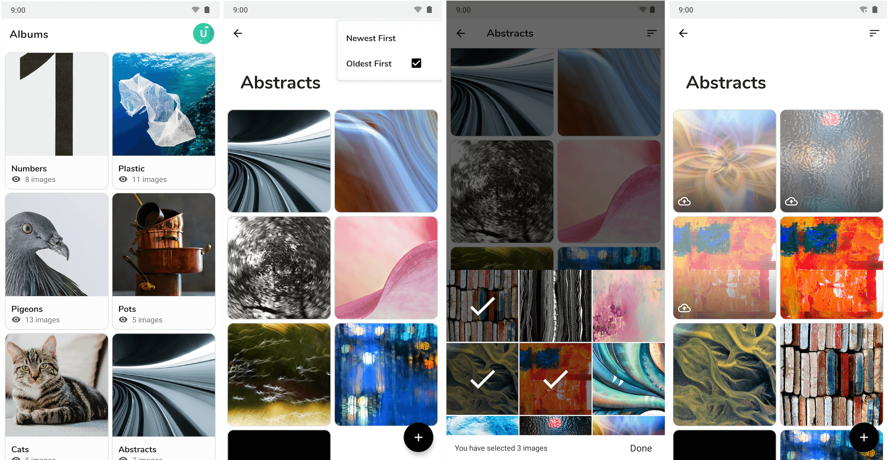

<h3>
Upgur
</h3>

<i>An offline-first Imgur client app that lets you view your albums and photos and upload new ones even if you are offline.</i>

It's a solution to an interview task and mainly consists of my explorations of Android Jetpack. It uses the following components:
- AppCompat
- Lifecycles
- LiveData
- Navigation
- Room
- ViewModel
- WorkManager
